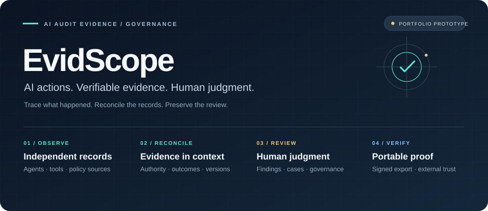
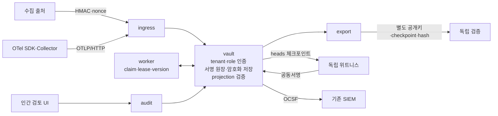
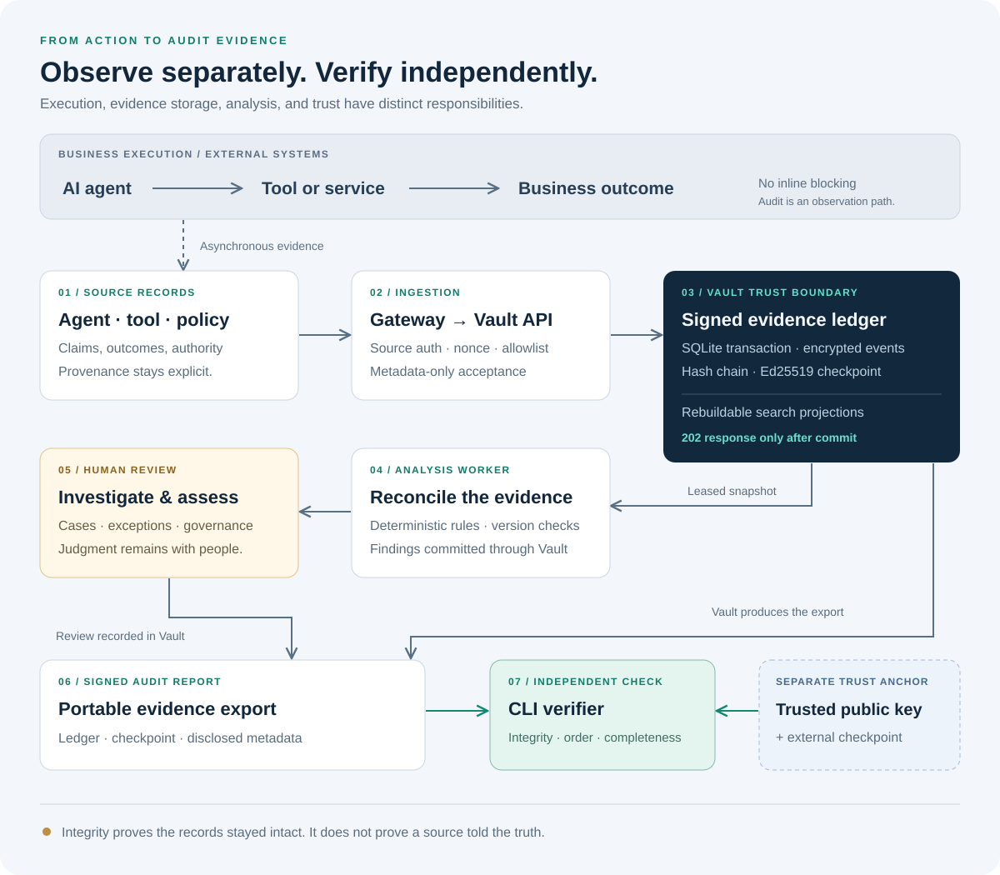

<div align="center">



# EvidScope

**AI 에이전트의 행동을 hook과 OpenTelemetry로 받아 위험을 탐지하고, 권한·정책·사람 판단과 묶어 외부 위트니스가 공동서명한 로그로 남겨 운영자를 믿지 않고도 검증하게 하는 증거 계층**

**Node.js 24 · SQLite · OpenTelemetry · C2SP transparency log · OCSF · QLoRA judge models · Human review**

[개발 기록](docs/dev-log/README.md) · [포트폴리오 컨텍스트](docs/portfolio-context.ko.md) · [증거 계층·차별점](docs/evidence-layer.md) · [에이전트 모니터링](docs/agent-monitoring.md) · [아키텍처](docs/architecture.md) · [검증 현황](docs/verification-status.md) · [전체 문서](docs/README.md)

</div>

---

> **2026-10-17 기준:** 오너 PC의 Claude Code·Codex 도구 호출을 hook으로 실시간 수집하고, 위험 규칙 67개와 행동 순서 규칙으로 경보를 내며, 확실한 위험만 실행 전에 막습니다. 경보는 서명된 대응표 v5로 ISMS-P·인공지능기본법·EU AI Act 항목에 연결됩니다. 규칙 오경보를 줄이는 판정 모델(JEV-9B, Qwen3-4B)은 임대 GPU에서 학습 회차를 이어 가는 중이며 아직 PC에 배포하지 않았습니다. 과정과 수치는 아래 [포트폴리오 소개](#포트폴리오-소개-로컬-모델의-실패에서-판정-오케스트라까지)에, 업데이트별 내용은 [개발 기록](docs/dev-log/README.md)에 있습니다.
>
> **2026-10-06 기준:** 개발 소스 **v0.1.2**, 검증된 이전 로컬 설치본 **v0.1.1**. 현재 소스의 반복 검증은 미완료이며 아래에 실패 범위를 보존합니다.
>
> **개선 1라운드(2026-10-06):** 적대적 감사 결과에 따라 "SIEM" 표현을 내리고 증거 계층으로 재정의했습니다. 수집은 OpenTelemetry 표준으로, 변조 증거는 C2SP 투명성 로그와 독립 위트니스로, 경보는 OCSF로 바꿨습니다. 변경 내용과 다음 라운드 후보는 [개선 라운드 기록](docs/improvement-rounds.md)에 있습니다.
>
> **개선 2라운드(2026-10-07):** heads 로그 서명 키를 vault 밖의 [heads 서명기](docs/signer.md)로 옮길 수 있게 해, 서명기를 켜고 검증자가 그 키와 origin base를 고정하면 vault 호스트를 장악한 공격자도 tenant를 되돌린 기록에 위트니스 공동서명을 받을 수 없게 했고, 원장에는 salt를 넣은 커밋먼트만 남기고 이벤트 키를 [키 epoch로 감싸](docs/event-key-wrapping.md) 파기가 백업까지 미치게 했습니다. 내보내기는 DSSE·in-toto 증명과 C2SP `tlog-proof` [영수증](docs/receipts.md)으로 받고 따로 배포하는 `evidscope-verify`로 확인합니다. ISMS-P 인증기준 101개 항목과의 [참고 정렬](docs/isms-p-alignment.md)을 고시 원문으로 고정했습니다. 인증 판정은 아닙니다.
>
> **개선 3라운드(2026-10-07):** 2라운드 기능의 재감사 결함 4건을 고쳤고, 에이전트를 서명된 [레지스트리](docs/agent-registry.md)에 등록해 수명 주기 전이를 4-eyes로 남기며 게이트웨이·정책 엔진의 결정을 받아 실제 실행과 대조합니다. 검토자가 내린 [정지 명령](docs/kill-switch.md)은 OPA 묶음과 서명된 거부 목록으로 집행 지점에 배포되고 전파 시각이 증거로 남으며, 정책 엔진이 승인을 요구하면 [사람 승인 대기열](docs/approval-queue.md)에서 답하고 게이트웨이가 서명된 답을 검증합니다. 차단은 여전히 집행 지점이 합니다.
>
> **개선 4라운드(2026-10-08):** 3라운드 기능의 재감사 결함 5건(검토자 한 사람의 승인 우회, 거부 목록 누락 등)을 고쳤고, A2A Agent Card와 Backstage 카탈로그의 에이전트를 출처를 서명해 [레지스트리](docs/agent-registry.md) 후보로 가져오며, OTLP 결정 span과 Cedar 결정도 받습니다.
>
> **개선 5라운드(2026-10-08):** 수집 경로를 계측해 그룹 커밋을 넣어 급증 처리량을 약 3배(초당 약 800건), OTLP 묶음을 약 2.2배(초당 약 1,650건)로 올렸고([수집 처리량](docs/performance.md)), 오프라인 검증을 통과한 판정만 Langfuse 점수와 Phoenix 주석으로 올려 팀이 이미 쓰는 trace 화면에서 증거 상태를 보게 했습니다([관측 도구 연동](docs/observability-integration.md)).

> **개선 6라운드(2026-10-08):** 감사인이 운영자를 믿지 않고 오프라인으로 확인할 수 있는 규제 증빙 묶음(EU AI Act·인공지능기본법·ISMS-P 항목별 증거 위치와 사람 판단, DSSE·in-toto 서명)을 추가했고([감사인용 증거 묶음](docs/evidence-pack.md)), 재감사에서 중간 등급 2건을 고쳤으며, 수집 처리량을 급증 약 1,030건·OTLP 약 1,870건(초당)으로 더 올렸습니다([개선 라운드 기록](docs/improvement-rounds.md)).

## 포트폴리오 소개: 로컬 모델의 실패에서 판정 오케스트라까지

EvidScope는 AI 코딩 에이전트가 실제로 한 행동을 실시간으로 받아 위험을 탐지하고, 운영자도 몰래 바꿀 수 없는 서명 원장에 남겨 ISMS-P·인공지능기본법·EU AI Act 검토 증거로 쓰게 하는 AI 거버넌스·보안 감사 도구입니다. 아래는 판정 모델을 만들며 부딪힌 문제와 푼 방법, 그리고 화면을 고쳐 온 과정입니다. 업데이트마다 무엇이 바뀌었고 어떤 문제를 어떻게 고민해 풀었는지는 [개발 기록](docs/dev-log/README.md)(항목 75개, 대안·결정 주체·지표 출처·면접 질문 포함)에, 다시 생각해 볼 질문은 [회고 노트](docs/dev-log/reflection.md)에, 이력서·면접 준비용 요약은 [포트폴리오 컨텍스트](docs/portfolio-context.ko.md)에 있습니다. 이력서 도구나 경력 분석 엔진은 같은 내용을 [career-profile.json](docs/dev-log/career-profile.json)과 [entries.jsonl](docs/dev-log/entries.jsonl)에서 구조화된 데이터로 읽을 수 있습니다.

### 1. 보안 때문에 로컬 모델을 골랐다

감사 대상인 에이전트 기록에는 명령, 파일 경로, 비밀값이 들어 있습니다. 외부 AI API로 보내면 감사 도구가 새 유출 경로가 됩니다. 그래서 기록이 PC 밖으로 나가지 않고 추가 API 비용도 0원인 로컬 모델을 택했습니다. 보안 특화 공개 모델(Foundation-Sec 8B)을 RTX 3080 12GB에서 QLoRA로 학습했습니다. ([판정 모델 기록](docs/dev-log/03-judge-models.md))

### 2. 기대에 못 미쳤다: 처음 보는 유형에서 무너졌고, 위협 탐지는 정적 규칙을 넘지 못했다

- 증거 문장을 규제 항목에 연결하는 파일럿 13번이 모두 승격 기준을 넘지 못했습니다(최고 보정 정밀도 0.958, 재현율 0.46). 초기에는 "가장 가까운 학습 예시를 베끼는" 단순 기준선이 학습 모델보다 높았습니다(47% 대 39%).
- 세션 판정 첫 학습은 처음 보는 60세션에서 1.0을 냈지만, 적대적 감사로 확인해 보니 평가 패턴이 학습에 섞인 누수였고 모델 없는 한 줄 규칙도 같은 점수를 냈습니다. 결과를 무효로 되돌렸습니다.
- 적대적 탐침 위협 13개 중 정적 규칙은 13개를 모두 잡았지만 학습 모델은 9개만 잡았고, 에이전트가 자기 기록 설정을 고친 세션 3개를 정상으로 지웠습니다.
- 마지막 시도(v2)는 오경보 정리에서 규칙보다 나았지만(판정 정밀도 0.92 대 0.66) 확신도가 늘 0.9로 고정돼 판단 보류가 작동하지 않았고, 규칙 소견을 빼면 유출을 정상으로 판정했습니다. 근거를 남기고 이 모델을 퇴역시켰습니다.

### 3. GPU를 빌려 두 판정 모델로 교차 검증했다

- 12GB 한 장으로는 두 모델을 같은 데이터로 동시에 학습할 수 없어 vast.ai에서 RTX 5060 Ti 16GB 2장을 빌렸습니다(시간당 약 $0.29, 크레딧 $5). 데이터 경계는 지켰습니다. 합성 시나리오와 공개 데이터만 외부로 나갔고, 실제 수집 세션 시험은 PC에서만 합니다.
- Qwen3-4B-Instruct와 판정 전용 모델 JEV-9B를 같은 답안지로 학습했습니다. 같은 경보에 정답이 다른 대조 쌍, 경보 이름을 가리거나 규칙 출력을 지운 변형, 공개 데이터 ASSEBench를 섞고, R-Judge는 외부 시험으로만 남겼습니다.
- 규칙 경보를 낮추려면 두 모델이 모두 동의해야 합니다. 두 모델이 동의할 때만 답하면 처음 보는 세션의 99.4%에 답하고 답한 것은 모두 맞았고(3회차), 4회차에서는 세 변형 1,050건 모두에 답하고 모두 맞았습니다.

### 4. 역할을 나눴다: JEV가 먼저 거르고, Qwen이 근거를 짚고, 조항은 코드가 계산한다

- **JEV-9B:** 글을 생성하지 않고 판정 블록이 예/아니오와 확률을 한 번에 냅니다. 처음 보는 세션 판정 정확도와 외부 일반화가 더 높아 모든 세션의 1차 판정을 맡습니다. 모델 크기는 Qwen3-4B보다 크고 세션당 시간은 비슷합니다(0.31초 대 0.38초). 비용과 응답 속도의 이점은 Qwen을 걸린 세션에만 부르는 구조에서 나옵니다.
- **Qwen3-4B:** 규칙 경보가 없어도 어느 행동이 증거인지 짚습니다(규칙 출력을 지운 시험에서 증거 단계 F1 0.86, JEV는 0). 그래서 JEV가 걸러낸 세션의 증거 행동과 위험 유형을 맡습니다.
- **코드:** 법 조항은 모델이 쓰지 않고 서명된 대응표가 계산합니다. 모델은 규칙 경보를 지울 수 없고, 방어 무력화·민감 접근 후 외부 전송·기록 변조 같은 보호 경보는 낮추지도 못합니다.

### 5. 결과 (2026-10-17)

| 지표 | 정적 규칙만 | Foundation-Sec 8B (퇴역) | Qwen3-4B (4회차) | JEV-9B (4회차) |
|---|---|---|---|---|
| 처음 보는 유형 세션 | 정확도 약 70% | 판정 정밀도 0.70 | 모두 답변, 모두 정답 (3회차 98.9% 답변) | 모두 답변, 모두 정답 |
| 놓친 위협 | 0 | 탐침 13개 중 4개 | 0 | 0 |
| 다른 종류 에이전트 (R-Judge) | | | 61% (안전 세션 205/269 과탐) | 87% (2회차 63%) |
| 공개 데이터 시험 (ASSEBench) | | | 94.0% (3회차 97.2%) | 96.9% |

- 처음 보는 유형 시험은 학습에 쓰지 않은 위협·정상 계열로 만든 350세션(2회차부터)이며, 경보 이름 가림·규칙 출력 제거 변형에서도 같은 결과입니다. 350세션 오류 0은 실제 정확도의 95% 신뢰 하한 약 99.1%에 해당합니다.
- 이 99%는 **우리가 설계한 위협 유형 안**의 결과입니다. 프롬프트 주입·도구 결과 속 지시·다른 에이전트 간섭·EvidScope 기록 변조는 5회차에서 학습 중이고, PC 배포와 실제 세션 측정, 오케스트라 전체 실행은 그 다음입니다.

### 6. 화면은 피드백을 받을 때마다 다시 만들었다

- 탭 11개 → 업무 메뉴 6개 → "지금 확인할 일" 첫 화면 → Datadog/Grafana풍 다크 운영 콘솔(대시보드, facet 검색, 히스토그램 클릭 확대, 2초 live tail, 행동마다 같은 세션에서 먼저 읽은 자료).
- "지금 어떤 에이전트가 돌고 있는지 모르겠다"에는 실행 중 에이전트 화면을, "UI가 별로"와 "참고 내용을 알 수 없다"에는 다크 콘솔과 세션 참고 자료를 만들었습니다.
- 경보 하나에 약 20줄이던 관련 법·인증 기준을 기준별 한 줄 번호로 압축했고, 데모 경보 63건은 원장을 건드리지 않고 보기 분류로 분리했습니다. 보존 화면 응답은 913KB에서 103KB로 줄었습니다.
- 원칙은 "판정이 아닌 것은 판정처럼 보이지 않게", "기록이 없다는 것은 안전하다는 뜻이 아니다"입니다. ([UI/UX 기록](docs/dev-log/04-ui-ux.md))

## 목적과 대상

실행 로그만으로는 AI가 실제로 무엇을 했고, 당시 권한이 있었으며, 어떤 근거를 검토했는지 설명하기 어렵습니다. EvidScope는 **AI 행동 → 독립 도구 결과 → 당시 권한·정책 버전 → 원본 문서 → 사람 판단**을 연결하고 서로 대조합니다.

SIEM이나 실행을 승인·차단하는 엔진이 아닙니다(예외는 Claude Code hook에서 맥락과 무관하게 확실한 위험만 막는 선택 모드입니다). 상관분석·대량 검색은 기존 SIEM과 관측 도구에 맡기고, 이 제품은 "그 행동이 권한 안에서 일어났고 기록이 사후에 바뀌지 않았다"는 증거에 집중합니다. 내부감사, AI 거버넌스 담당자, 보안 운영팀이 근거를 확인하고 판단을 기록하는 도구입니다. 등록된 AI 자산, 실제로 받은 기록, 증거 커버리지를 분리해서 "등록됨"과 "확인됨"을 혼동하지 않도록 설계했습니다.

> 법률 준수 인증과 실제 금융기관 연동은 완료되지 않았습니다.

## 지원 기능

| 영역 | 내용 |
|---|---|
| AI 에이전트 모니터링 | Claude Code·Codex의 도구 호출을 hook으로 실행 전·후 서명 수집합니다. hook은 기본적으로 작업을 막지 않고, EvidScope가 꺼져 있으면 대기열에 둡니다. 도구 결과는 원문 없이 신호 라벨·개수·해시만 보냅니다. hook 설치 이전 행동은 대화 기록에서 메타데이터만 소급 수집합니다. Ollama·vLLM·LM Studio 같은 로컬 모델 서버 호출은 앞단의 기록 프록시가 본문 없이 같은 방식으로 기록합니다. [에이전트 모니터링](docs/agent-monitoring.md), [로컬 모델 기록 프록시](docs/local-model-proxy.md) |
| 위험 탐지 | 위험 규칙 67개(규칙 팩 v3, 정규식 없는 단어 순서 연산자)와 행동 순서 규칙(민감 파일 읽기 뒤 외부 전송, 보안 기능 해제 뒤 위험 행동, 주입 문구를 읽은 뒤 위험 행동 등). 경보는 서명된 대응표 v5로 ISMS-P·인공지능기본법·EU AI Act 항목에 연결됩니다(증거 위치이지 준수 판정이 아닙니다). |
| 실행 전 차단(선택) | 감사·수집 설정 조작, 보안 기능 끄기, 비밀을 읽어 바로 외부로 보내는 명령처럼 맥락과 무관하게 확실한 것만 Claude Code hook에서 막고, 막은 사실을 원장에 남깁니다. |
| 판정 모델(배포 전) | 규칙 오경보를 줄이는 판정 오케스트라: 규칙 → JEV-9B 1차 판정 → 걸린 세션만 Qwen3-4B가 증거 행동·유형 → 서명된 표가 조항 계산. 경보를 낮추려면 두 모델이 모두 동의해야 하고 보호 경보는 낮출 수 없습니다. [판정 모델 기록](docs/dev-log/03-judge-models.md) |
| 수집 | 이미 쓰는 OpenTelemetry SDK·Collector가 GenAI span을 OTLP/HTTP `/v1/traces`(JSON·protobuf, gzip·deflate·zstd)로 보내면 허용 목록 메타데이터만 증거로 남깁니다. 본문 속성은 고객망 Collector와 ingress에서 지웁니다. 기존 HMAC 출처(권한·도구·안전)와 Zeek 메타데이터 경로도 유지합니다. [Collector 설정](deploy/otel-collector/README.ko.md) |
| 변조 증거 | tenant별 RFC 6962 Merkle 트리와 C2SP 체크포인트, 모든 tenant를 묶은 heads 로그를 독립 위트니스(litewitness 등)가 공동서명합니다. enforce 모드에서는 DB 되돌리기·이력 분기·tenant 삭제를 탐지해 시작을 거부하거나 격리합니다. [운영 가이드](docs/transparency-log.md) |
| 오프라인 검증 | 내보낸 묶음과 사례 보고서를 공개키·위트니스 정족수로 검증하고, `--replay`로 서명된 분석 결과를 원장 순서대로 다시 계산해 숨긴·지어낸 발견사항을 찾습니다. |
| SIEM 연동 | 발견사항을 OCSF Detection Finding(1.3.0 기본, 1.9.0 선택)으로 내보내고 Splunk HEC로 보낼 수 있습니다. 1.9.0은 원장 레코드 해시와 투명성 로그 origin을 attestation에 담습니다. |
| 근거 문서 | 일반 문서는 최대 4MiB 실파일을 암호화 보관·복구하며, 버전이 바뀌면 재검토합니다. 공급사 묶음은 별도 상한과 계약을 따릅니다. |
| 요구사항 | 요구사항 31개(한국 18개), 기술검사 23종(공급사 대체 근거 3종 포함), 시스템 schema 버전 4를 다룹니다. 미확인 사실은 `unknown`으로 보존하고 적용 후보와 사람의 최종 판단을 구분합니다. |
| 검토·보고 | 보완 과제를 관리하고 근거 없는 종결을 거부합니다. 보고서는 서명으로 고정합니다. |
| 보안·운영 | OIDC 세션 회수, tenant 격리, 암호화 백업과 새 경로 복구를 지원합니다. 문서·백업 암호화 키는 서명 키와 분리했습니다. [키 분리 가이드](docs/data-key-separation.md) |

법적 지원 범위는 코드에 정의된 목록이며, 법률상 완결성을 뜻하지 않습니다.

## 구조와 스택





시스템은 ingress, audit, vault, worker 네 개 프로세스로 나뉩니다. 최종 인증과 원장은 vault가 소유하고, worker는 claim·lease·version 방식으로 분석합니다. 인간 검토 UI는 분석 경로와 분리되어 있습니다.

- **런타임**: Node.js 24.15.x ESM(`node:http`, `node:crypto`, `node:sqlite`), SQLite WAL, Vanilla JS/CSS
- **인증·무결성**: openid-client 6.8.8(OIDC), Ed25519 서명, HMAC/nonce 기반 출처 인증
- **배포**: Docker·Kubernetes 배포 도구
- **분석 방식**: 탐지와 차단, 조항 계산은 상시 LLM 없이 결정적 규칙과 서명된 표가 맡습니다. 판정 모델(JEV-9B, Qwen3-4B)은 규칙 오경보를 낮추는 2선이며, Python/PyTorch/Transformers/PEFT(QLoRA)로 학습합니다. 학습은 로컬 RTX 3080과 임대 GPU(vast.ai, 합성·공개 데이터만)에서 했고, 추론은 PC에서 돌릴 예정입니다.

## 구현 문제 해결

**1. 서명 원장 재검증 병목**

요청마다 전체 원장을 재검증하면서 처리 속도가 떨어졌습니다. 이를 다음과 같이 해결했습니다.

- transaction checkpoint batching을 도입했습니다.
- 검증된 checkpoint 이후의 새 suffix와 projection delta를 검증합니다.
- 변조가 감지되면 fail-closed로 처리합니다.
- 전체 export, integrity 검사, backup은 여전히 전체를 검증합니다.

2026-10-05 합성 로컬 시험에서 **1,000/1,000건**을 접수했고, sustained **600/600건·p95 206.81ms**, 최종 backlog 0을 기록했습니다. 시험 환경은 i7-12700F, 32GiB, Windows, SQLite WAL, writer 1개·worker 2개였습니다. 단일 시험 결과이며 운영 SLA가 아닙니다. [원본 벤치마크](reports/benchmark-2026-10-05T06-29-04-501Z.json).

**2. 감사자의 거버넌스 변경 권한**

reviewer·admin 권한 검사를 적용했습니다. 실제 HTTP 거부 30건에서 서명 상태가 바뀌지 않는지 회귀 시험으로 고정했습니다. 실제 인증과 독립 검증·복구가 이 프로젝트의 핵심 구현 사례입니다.

**3. 문서의 존재와 충분한 근거를 구분**

암호화한 실파일의 hash·복구 가능성과 모델·목적·정책 버전을 대조합니다. 문서 손상이나 버전 변경은 재검토로 이어지며, 근거가 부족한 과제는 종결을 거부합니다. [문제 → 구현 → 결과 상세](docs/product-overview.md#6-어떤-구현으로-어떤-문제를-해결했는가).

## 검증 결과

아래 결과는 서로 다른 소스와 시험 범위에서 나왔습니다.

- **이전 설치본 0.1.1(검증 완료)**: 전체 회귀 758/758, 39개 시험 10회 연속(390개), 제한 Linux 이미지 39/39
- **현재 개발 소스 0.1.2**: 반복 시험 8회 통과 후 9회차 117/119(2건 실패). 10회 반복은 완료되지 않았습니다.
- **과거 실행 로그** [소스 전체 검사](reports/source-full-continuation-r3-final-20261006.log): 836/836, 실패 0. 이번 게시 작업에서 새로 수행한 시험이 아닙니다.

실패 원인과 재검증 범위, 각 버전의 원본 링크는 **[검증 현황](docs/verification-status.md)**에 모았습니다.

## 모델 연구

현재 판정 모델 트랙의 과정과 회차별 수치는 위 [포트폴리오 소개](#포트폴리오-소개-로컬-모델의-실패에서-판정-오케스트라까지)와 [판정 모델 기록](docs/dev-log/03-judge-models.md)에 있습니다. 요약하면 다음과 같습니다.

| 단계 | 모델 | 결과 |
|---|---|---|
| 09-22 → 10-06 | Foundation-Sec-8B-Reasoning, 공개 한국어 QA(KLUE MRC) QLoRA | 향상분 대부분이 출력 형식(모든 조건 충족 0/128 → 60/128) |
| 10-08 → 10-15 | Foundation-Sec-1.1-8B-Instruct, 증거 문장 → 규제 항목 매핑 파일럿 13번 | 모두 승격 기준 미달(최고 보정 정밀도 0.958, 재현율 0.46) |
| 10-16 → 10-17 | 같은 모델, 세션 판정 3번 | 첫 1.0은 누수로 무효, 탐침 위협 13개 중 9개, 고정 확신도로 보류 불가 → 퇴역 |
| 10-17 | Qwen3-4B·JEV-9B, 임대 GPU 1~4회차 | 처음 보는 유형 세션 모두 정답(4회차 두 모델 모두), 두 모델 동의 시 1,050건 모두 답변·정답, R-Judge JEV 63% → 87% |
| 진행 중 | 5회차 | 프롬프트 주입·도구 결과 속 지시·에이전트 간섭·EvidScope 기록 변조 시나리오 추가 |

학습·평가 라벨은 설계로 만든 합성 데이터와 공개 데이터이며 사람이 검토한 라벨은 없습니다. 판정 모델은 PC 배포와 실제 세션 측정 전이므로 화면의 판정을 바꾸지 않습니다.

이전 기록: Foundation-Sec-8B-Reasoning의 공개 KLUE QA 학습에서 관측 64문항 엄격 통과는 16/64 → 25/64로 늘었지만 답변 가능 문항은 12/32 → 9/32로 줄었습니다(최신 80회 후보의 평가 결과는 아님).

## 발전 방향 (미완료)

- 판정 모델 5회차, PC(RTX 3080 12GB) 배포와 실제 세션의 속도·메모리·오탐률 측정, 오케스트라 전체 실행
- 판정 이유를 문장으로 쓰는 reason 필드, 거버넌스 판정 자리(gpt-oss-safeguard-20b, 조항 요구사항을 정책으로 주는 방식)
- 프롬프트 검사(주입·탈옥), 세션 단위 사건 묶기와 담당자·상태, Slack·메일 알림, 에이전트가 아닌 로그 수집
- hook 자기 보고를 교차 확인할 독립 관측(OS 프로세스·네트워크, 프록시·DNS·VPC 흐름), 사내망·VPC 배포
- 실제 조직 IdP, 정책·업무 결과 연동, Sentinel·Security Lake 전송
- 독립 운영 위트니스 확보와 공개 위트니스 네트워크 등록
- 원격 DMS·KMS·WORM·HA 검증
- 실제 운영 부하와 복구 목표 측정
- 미관측 평가와 사람 검토를 거친 모델 승격

향후에는 같은 감사 과제에서 근거 탐색 시간·누락 발견·연동 비용도 측정하려고 합니다. 현재 고객 성과나 상용 제품 대비 우위로 제시할 측정값은 없습니다. [방향별 완료 조건](docs/product-overview.md#8-발전-방향과-완료-조건).

## 실행

Node.js **24.15.x**가 필요합니다. 최초 실행 시 로컬 자격·키·DB를 만들며 모델·GPU 학습은 시작하지 않습니다.

```powershell
git clone https://github.com/ki0915/EvidScope.git
cd EvidScope
npm ci --ignore-scripts --no-audit --no-fund
npm start
```

기본 감사 화면은 **http://127.0.0.1:8082**입니다. `.local/config.json`의 역할별 토큰을 화면에 입력합니다. auditor는 조회 전용 역할이 아닙니다. 역할은 다음과 같습니다.

| 역할 (로컬 계정) | 할 수 있는 일 | 할 수 없는 일 |
|---|---|---|
| auditor (`alpha-auditor`) | 조회, 사건 생성·의견·과제 기록, 사람 판단 기록, 예외 요청, 다른 사람이 연 사건의 종결 | 자신이 열거나 다시 연 사건의 종결, 예외·룰 승인, 거버넌스 시스템·평가·과제 변경 |
| reviewer (`alpha-reviewer`) | auditor 권한 + 거버넌스 변경·검토, 룰 작성·시험, 다른 사람이 작성한 룰·예외 승인, 다른 사람이 작성한 거버넌스 평가의 법률 검토 확인 | 자기 작성물(룰·예외)의 단독 승인, 자기 평가의 법률 검토 확인, 자기 평가가 포함된 거버넌스 과제 종결 |
| admin (`alpha-admin`) | reviewer 권한 + 검색 사본 재구축, 접근 관리 | 자기 작성물의 단독 승인·법률 검토 확인·과제 종결 |

예외 요청은 다른 reviewer 또는 admin이 승인하기 전에는 분석 결과에 영향을 주지 않습니다. 사건 종결, 예외 승인, 거버넌스 평가의 법률 검토 확인과 과제 종결처럼 결과를 확정하는 변경은 작성자와 다른 사람이 해야 합니다(4-eyes). 평가 작성자가 입력한 `legalReview`는 주장으로만 표시되고, 다른 reviewer·admin이 그 평가 내용(해시)에 확인을 기록해야 `legalStatus`가 `reviewed`가 됩니다. 작성자가 `reviewed`를 입력해도 법률 검토 과제는 열리고, 독립 확인 전에는 종결할 수 없습니다. 증거가 vault가 확인하지 않은 진술·외부 참조뿐이면 보고서에 `self_asserted`로 표시됩니다. vault는 공급사 서명을 검증하지 않으므로, 공급사 증빙 묶음은 실제 자료로 신고되고 평가 작성자가 아닌 사람이 출처를 확인한 경우에만 출처에 묶인 증거(`vault_retained_supplier_bundle`)로 셉니다. 자격 파일은 공개하거나 공유하지 않습니다.

별도 터미널에서 `npm run demo`를 실행하면 합성 사례가 추가됩니다. 데모는 OpenTelemetry GenAI span도 `/v1/traces`로 보내므로 AI 가시성 화면에 등록 자산·미등록 자산·허용 목적지 밖 호출이 나타납니다. Windows에서 IPv4 loopback 오류가 있다면 서버·데모 양쪽에 `$env:EVIDSCOPE_LOCAL_HOST='::1'`을 설정하고 **http://[::1]:8082**로 접속합니다. `Ctrl+C`로 실행기가 시작한 자식 프로세스를 종료합니다.

2026-10-06 이전에 만든 `.local`이 있다면 `npm start`를 멈추고 `npm run upgrade:local -- --transparency`를 한 번 실행하세요. OTLP 출처 자격 추가, 데이터 키 분리와 문서 재암호화, 투명성 로그(monitor) 설정을 하며 바꾸는 파일은 먼저 `.local/upgrade-backup-<시각>/`에 복사합니다. `--dry-run`으로 미리 확인할 수 있습니다. [설치·백업·복구 상세](docs/first-release-20261006.md), [권한 패치](docs/first-release-security-patch-20261006.md).

## 검증

핵심 공개 경로부터 확인할 수 있습니다.

```powershell
node --test --test-concurrency=1 test/action-integrity.test.mjs test/receipt-integrity.test.mjs test/governance-authorization.test.mjs test/finance-known-reference.test.mjs test/kr-governance-33-http.test.mjs test/governance-documents.test.mjs test/vault-recovery.test.mjs
```

전체 검사는 `npm test`입니다. 일부 연구 테스트는 공개하지 않는 로컬 학습 영수증·모델 잠금 파일을 요구하며, 해당 파일 묶음이 없으면 경로와 이유를 표시하고 건너뜁니다. 연구 PC에서는 `$env:EVIDSCOPE_REQUIRE_RESEARCH_ARTIFACTS='1'`로 건너뛰기 대신 실패하게 합니다. `npm run check`는 문법·바이트 위생·줄 길이 기준을, `npm run test:ci`는 전체 검사와 CI 판정(실패·취소·이유 없는 건너뛰기 0)을 실행합니다. 모두 통과한 실행은 `.test-runs`에 만든 시험 자격·키를 지우며(진단 파일 `harness-failure-*.json`은 보존), 보존하려면 `$env:EVIDSCOPE_KEEP_TEST_RUNS='1'`을 설정합니다. 새 clone과 과거 설치본의 시험 범위를 구분하고 [검증 안내](docs/verification-status.md)를 확인하세요. Windows 테스트의 IPv6 선택은 `$env:EVIDSCOPE_TEST_HOST='::1'`입니다.

---

소스, 합성 fixture, 개발·검증 기록을 공개합니다. 로컬 자격·개인키·DB·모델 가중치·개인 작업 메모는 제외합니다. 별도 오픈소스 라이선스는 부여하지 않았으며 현재 `UNLICENSED`입니다. 과거 문서와 PDF는 해당 날짜의 기록으로 보존합니다.
