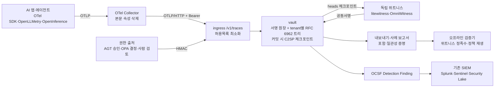

# 증거 계층 아키텍처와 차별점

> 2026-10-06 적대적 감사 이후 개선 1라운드의 방향과 결과입니다. 감사 원문은 프로젝트 보고서
> `EvidScope-적대적감사-보고서-2026-10-06.md`이며, 라운드별 진행과 다음 후보는 [개선 라운드 기록](improvement-rounds.md)에 둡니다.

## 1. 한 줄 정의

**EvidScope는 SIEM이 아니라 "AI 에이전트 행동 증거 계층"입니다.** 이미 쓰는 OpenTelemetry로 AI 행동을 받아 최소화된 증거로 바꾸고,
행동을 권한·정책 버전·사람의 판단과 묶은 뒤, **운영자를 믿지 않아도 외부 위트니스와 오프라인 검증기로 확인할 수 있는 로그**로
남깁니다. 경보는 기존 SIEM이 읽는 OCSF로 내보냅니다.

감사에서 확인한 사실이 이 방향을 정했습니다.

- 실제 수집 연동이 없었고 자체 수집기·SDK를 만들고 있었습니다. 수집은 이미 표준(OpenTelemetry)과 성숙한 오픈소스가 있습니다.
- 원장 서명은 있었지만 DB를 예전 사본으로 되돌리거나 tenant를 지우는 공격을 탐지하지 못했습니다(S1·S2).
- 처리량 한계(약 160~240 EPS 버스트)와 조회마다 원장 전체를 다시 검증하는 구조가 병목이었습니다.
- "SIEM"이라는 이름은 상관분석·UEBA·대량 검색을 약속하지만 이 제품의 강점은 거기에 있지 않습니다.

## 2. 구조

## 3. 만들지 않고 연결한 것

입력 쪽(계측·전송·버퍼링·본문 제거·저장·검색 UI)은 만들지 않고 표준에 붙입니다. 직접 만드는 것은 OTLP 수신기와 증거 매퍼,
증거 원장과 투명성 로그, 검증기, 사람 검토 흐름, 한국 규제 증거 묶음, OCSF 출력뿐입니다.

| 구성요소 | 결정 | 사용하는 표준·프로젝트 | EvidScope가 만드는 최소 범위 |
|---|---|---|---|
| 수집 | 연결 | OpenTelemetry SDK, [OpenLLMetry](https://github.com/traceloop/openllmetry), [OpenInference](https://github.com/Arize-ai/openinference), [OTel Collector](https://github.com/open-telemetry/opentelemetry-collector) core | `/v1/traces` 수신기(JSON·protobuf·gzip/deflate/zstd), GenAI span → 증거 이벤트 매퍼 |
| 스키마 | 채택 | [OTel GenAI semconv](https://github.com/open-telemetry/semantic-conventions-genai) 입력, [OCSF](https://github.com/ocsf/ocsf-schema) 출력 | 매핑표와 권한·승인 참조용 `evidscope.*` 이름공간만 |
| 텔레메트리 저장·검색 | 연결 | [Langfuse](https://github.com/langfuse/langfuse), [Phoenix](https://github.com/Arize-ai/phoenix), SIEM | 증거 원장과 projection, trace ID 연결 |
| 변조 증거 | 표준대로 작게 구현 | RFC 6962 Merkle, [C2SP](https://github.com/C2SP/C2SP) signed-note·tlog-checkpoint | 의존성 없는 `src/tlog.mjs`(C2SP 시험 벡터로 검증) |
| 위트니스 | 연결 | C2SP tlog-witness·cosignature, [litewitness](https://github.com/FiloSottile/torchwood), [OmniWitness](https://github.com/transparency-dev/witness) | 제출 클라이언트(pump)와 정책. 위트니스 서버는 만들지 않음(시험용 제외) |
| 정책 | 연결 | [OPA](https://github.com/open-policy-agent/opa)·[Cedar](https://github.com/cedar-policy/cedar)·[MS AGT](https://github.com/microsoft/agent-governance-toolkit) 결정을 증거로 수집 | 기존 결정적 `evaluate()` 유지, 새 정책 언어는 만들지 않음 |
| SIEM 전달 | 직렬화만 구현 | OCSF Detection Finding(2004) | OCSF 변환기. 상관분석·UEBA·SOAR는 만들지 않음 |
| 규제 매핑 | **직접 구현(차별점)** | 인공지능기본법, 금융분야 AI 가이드라인 | 조문 단위 요구사항·기술검사·적용 판단 |

이번 라운드에서 자체 수집기 위주의 설계를 OTLP 표준 수신으로 바꾸고, 머클 트리·체크포인트·위트니스 형식을 모두 C2SP 표준으로 맞췄습니다.
실제 OTel Collector(0.140)·OTel JS SDK·litewitness와 상호운용 시험을 통과했습니다.

## 4. 우리만의 차별점

GitHub와 IETF 문서를 조사한 결과, 해시 체인 서명 원장·오프라인 검증기·OTLP 수집·일반 규제 매핑은 이미 흔합니다
([auditant](https://pypi.org/project/auditant/), [MS AGT](https://github.com/microsoft/agent-governance-toolkit), IETF 에이전트 영수증 초안들,
Langfuse·Phoenix). 그래서 차별점을 아래 다섯 가지로 좁혔습니다.

### D1. 위트니스가 공동서명하는, 되돌리기를 거부하는 증거 로그 (이번 라운드 구현)

- **무엇:** tenant별 RFC 6962 트리와 C2SP 체크포인트, 모든 tenant 머리를 묶은 heads 로그를 독립 위트니스가 일관성 확인 후 공동서명합니다.
  enforce 모드에서 rollback·fork·tenant 삭제가 보이면 시작을 거부하거나 격리합니다. 내보낸 묶음과 사례 보고서는 포함 증명을 담아
  오프라인에서 위트니스 정족수까지 검증합니다.
- **경쟁 제품과의 차이:** MS AGT는 명세에서 "현재 구현은 외부 앵커링을 하지 않는다"고 밝히고 Merkle에 도메인 분리·서명된 머리가 없습니다.
  auditant는 RFC 3161 타임스탬프와 S3 Object Lock을 쓰는데, 타임스탬프 기관은 받은 해시에 서명할 뿐 두 갈래 이력(equivocation)을 막지 못합니다.
  IETF noa 초안은 equivocation 탐지를 범위 밖으로 둡니다.
- **확인 방법:** `test/transparency-server.test.mjs`(예전 DB 사본으로 enforce 시작 거부), `test/litewitness-interop.test.mjs`(실제 litewitness에서 rollback
  거부, fork 422 → 격리). 운영은 [투명성 로그 가이드](transparency-log.md).
- **아직 막지 못한 것:** 서명 키까지 가진 공격자는 heads 로그를 정상적으로 늘리면서 그 안의 tenant 하나만 예전 상태로 되돌릴 수 있습니다
  (재검토에서 확인). tenant 로그를 위트니스에 직접 등록하는 작업이 끝나기 전까지 heads 기반 롤백 확인은 DB만 조작하는 공격자(S1) 기준입니다.
- **모방 위험:** 중상. 암호 기법 자체가 아니라 fail-closed 운영 의미(tenant 삭제 탐지, 복구 epoch)와 고객 자체 위트니스 운영 패키지가 해자입니다.

### D2. 권한에 묶인 증거 사슬과 결정적 오프라인 정책 재생

- **무엇:** 에이전트의 자기보고 ↔ 권한 출처의 부여·위임·사람 승인 ↔ 당시 정책 버전 ↔ 도구 결과 ↔ 사람 검토를 한 tenant 로그에 둡니다.
  승인이 실행보다 먼저였다는 사실을 서명자가 고른 시각이 아니라 위트니스가 서명한 로그 위치로 증명합니다. 에이전트 출처는 `human_approval`을
  주장할 수 없습니다(출처별 허용 종류). 분석 `evaluate()`는 LLM 없이 결정적이므로 검증기가 내보낸 기록과 정책 버전으로 발견사항을 다시 계산해
  서명된 결과와 대조할 수 있습니다.
- **경쟁 제품과의 차이:** IETF noa 초안은 "검증자는 이 필드로 순서를 추론하면 안 된다", 오프라인 정책 재생은 범위 밖이라고 적습니다.
  AGT는 시도를 기록할 뿐 결과를 기록하지 않는다고 스스로 밝힙니다. OTel GenAI semconv에는 승인·권한·정책 속성이 없습니다.
- **이번 라운드 구현:** 분석 기록이 입력 이벤트 순번·규칙 버전·예외 수·엔진 ID(`evidscope-evaluate-v1`)를 함께 서명하도록 했고,
  검증기가 각 분석 기록보다 앞선 원장 레코드만으로 결과를 다시 계산해 서명된 결과와 정확히 비교합니다.
  운영자가 발견사항을 숨기거나 지어낸 뒤 사슬 전체를 다시 서명해도 서명 검증은 통과하지만 재생에서 `mismatch`로 잡힙니다.
  분석 뒤에 승인된 규칙을 소급 적용하는 것도 잡힙니다. 도구 실행보다 뒤에 기록된 승인은 출처가 시각을 앞당겨 적어도
  `approvalRecordedAfterExecution`으로 드러납니다. 입력 이벤트가 정당하게 파기된 기록은 `not_replayable`로 이유와 함께 보고합니다.
- **확인 방법:** `node scripts/verify.mjs export.json trust-anchor.pem --replay` 또는 `node scripts/replay-findings.mjs export.json trust-anchor.pem`
  (위트니스 옵션을 함께 주면 순서를 공동서명된 체크포인트에 고정). 시험은 `test/policy-replay.test.mjs`.

### D3. 조문 단위 한국 규제 증거 묶음

- 인공지능기본법(법률 제21311호) 제30~36조·제40조, 금융위원회 금융분야 AI 가이드라인, 금융감독원 AI RMF를 조문 단위로 매핑합니다.
  요구사항 31개(한국 18개), 기술검사 23종, 적용 판단은 "후보"와 사람의 최종 판단을 분리합니다. 각 통제가 문서 업로드가 아니라
  D1·D2의 검증 가능한 증거를 가리키도록 묶는 것이 다른 GRC 제품과의 차이입니다(AGT·ServiceNow·auditant는 EU·NIST 중심).
- **모방 위험:** 중상. 매핑표 자체는 복제되므로 법률 검토를 거친 매핑과 국내 확인제·ISMS-P 정렬이 필요합니다(다음 라운드 후보).

### D4. 검증 가능한 최소화와 파기

- 본문은 고객망의 Collector와 ingress에서 지워지고 vault에는 지문과 허용 메타데이터만 들어갑니다. 보관 이벤트는 키 파기로 지워도 사슬 검증이
  유지되며, 검증기는 파기가 이벤트 뒤에 일어났는지와 파기된 본문이 공개되지 않았는지를 확인합니다.
- 이번 라운드에서 감사 S4(삭제 후 SQLite 잔여 페이지)를 `secure_delete`와 WAL truncate로 고치고 회귀 시험을 추가했습니다.
  데이터 키도 서명 키와 분리했습니다([데이터 키 분리 가이드](data-key-separation.md)).

### D5. 위트니스 체크포인트에 연결된 OCSF 발견사항 (가장 약함)

- 발견사항을 OCSF Detection Finding(2004)으로 내보내 기존 SIEM에서 받고, 각 발견사항이 증거 로그의 체크포인트를 가리키게 합니다.
  `GET /api/export/ocsf?version=1.3.0|1.9.0`, `scripts/export-ocsf.mjs`(검증 후 NDJSON, 선택적으로 Splunk HEC 전송).
  1.9.0의 `attestation_list`는 원장 레코드 해시를 fingerprint로, 투명성 로그를 켠 경우 tenant의 C2SP origin을 `chain_uid`로 담아
  SIEM 분석가가 발견사항 하나를 위트니스가 서명한 로그까지 거슬러 검증할 수 있습니다.
  스키마 기능이라 누구나 따라 할 수 있으므로 단독 차별점이 아니라 D1·D2의 연동 증명으로 봅니다. Amazon Security Lake 사용자 정의 소스는
  OCSF 1.3까지만 받으므로 1.3 하위 호환 출력을 기본으로 둡니다.

### 차별점이 아닌 것

해시 체인 Ed25519 원장과 오프라인 검증기, OTLP 수집과 GenAI 대시보드, 일반 규제 매핑(EU·NIST·ISO), 정책 집행(OPA·Cedar·AGT),
런타임 가드레일(NeMo Guardrails·Guardrails AI)은 이미 흔하므로 차별점으로 내세우지 않습니다.

## 5. 겹치는 제품 비교

| 기능 | EvidScope | auditant | MS AGT | Langfuse·Phoenix | IETF 초안 |
|---|---|---|---|---|---|
| OTel로 에이전트 행동 수집 | 예(이번 라운드) | 예 | 예 | 예 | 해당 없음 |
| 해시 체인 서명 기록 | 예 | 예 | 체인 예, 머리 서명 없음 | 아니오 | 예 |
| RFC 6962 + 서명 체크포인트 | 예(이번 라운드) | 아니오 | 비표준 트리 | 아니오 | 아니오 |
| 외부 위트니스·fork 탐지 | 예(이번 라운드) | 타임스탬프만 | 외부 앵커 없음 | 아니오 | 범위 밖 |
| rollback·tenant 삭제 fail-closed | 예(enforce) | 부분 | 아니오 | 아니오 | 아니오 |
| 에이전트가 승인을 주장할 수 없음 | 예 | 서버 대조 | 승인자 ID가 해시 밖 | 아니오 | 아니오 |
| 오프라인 정책 재생 | 예(이번 라운드) | 아니오 | 온라인 Decision BOM | 아니오 | 범위 밖 |
| 검증 가능한 파기 순서 | 예 | 불명 | 아니오 | 삭제만 | 아니오 |
| 한국 인공지능기본법·금융 가이드라인 | 예 | 아니오 | 아니오 | 아니오 | 아니오 |

## 6. 정직한 한계

- 실제 고객 환경 연동, 운영 부하 측정, 법률 검토를 거친 매핑은 아직 없습니다.
- 위트니스 보증은 위트니스가 운영자와 독립적일 때만 의미가 있습니다. 같은 사람이 운영하는 위트니스는 기능 확인용입니다.
- 서명 키와 데이터 키는 같은 vault 프로세스가 읽습니다. HSM·KMS 연동은 다음 단계입니다.
- 모델 연구(KLUE 미세조정)는 감사에서 상수 기준선보다 낮은 점수가 확인되어 제품 차별점에서 제외했습니다.

## 참고 자료

- C2SP 명세: https://github.com/C2SP/C2SP · torchwood/litewitness: https://github.com/FiloSottile/torchwood · OmniWitness: https://github.com/transparency-dev/witness
- Tessera: https://github.com/transparency-dev/tessera · Sigsum: https://www.sigsum.org · 위트니스 네트워크: https://witness-network.org
- OTel GenAI semconv: https://github.com/open-telemetry/semantic-conventions-genai · OTel Collector: https://github.com/open-telemetry/opentelemetry-collector
- OCSF: https://github.com/ocsf/ocsf-schema · Security Lake 사용자 정의 소스: https://docs.aws.amazon.com/security-lake/latest/userguide/custom-sources.html
- MS Agent Governance Toolkit: https://github.com/microsoft/agent-governance-toolkit · auditant: https://pypi.org/project/auditant/
- IETF: draft-noa-scitt-ai-agent-receipt, draft-sahu-agent-action-receipts, draft-kuehlewind-audit-architecture, RFC 9943(SCITT)
